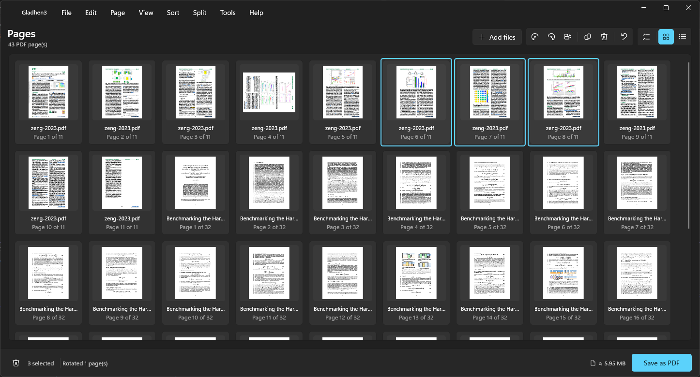
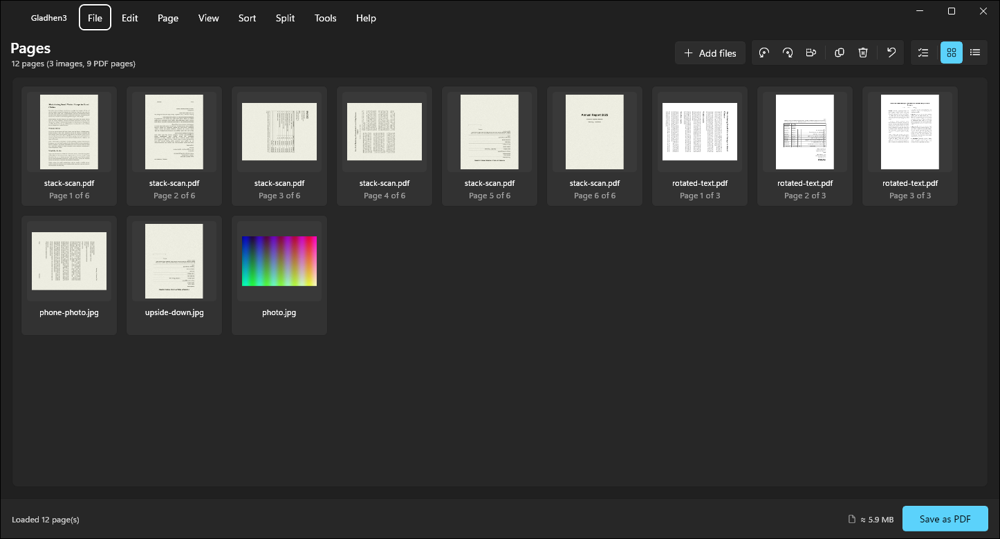
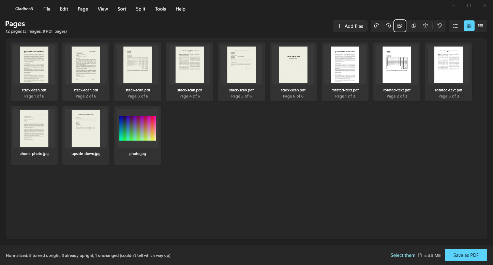
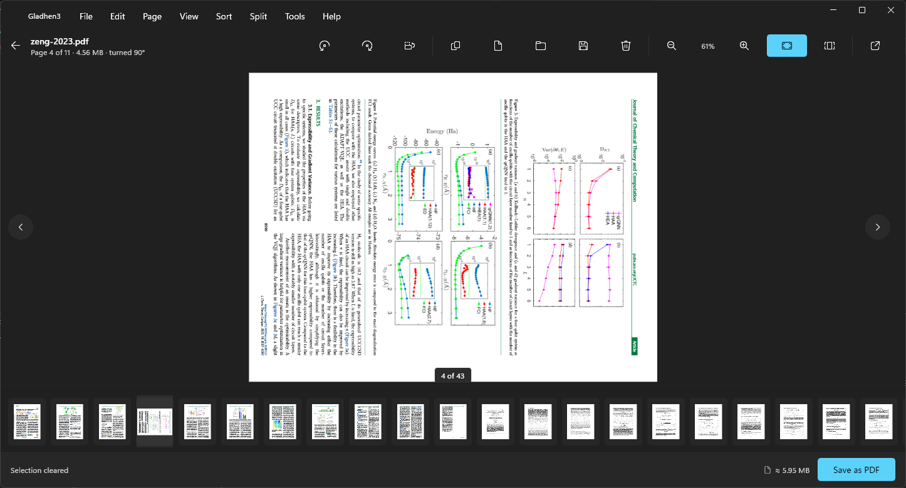
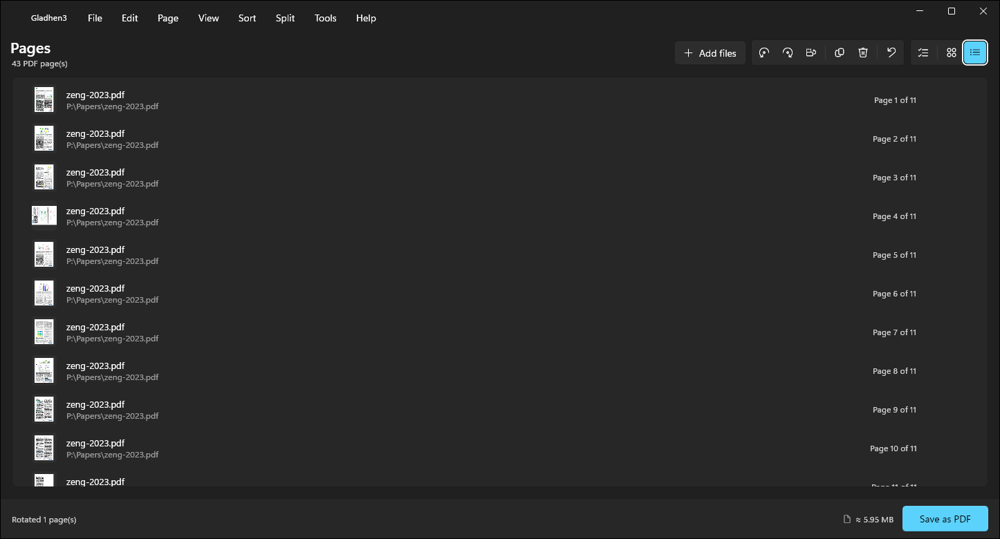
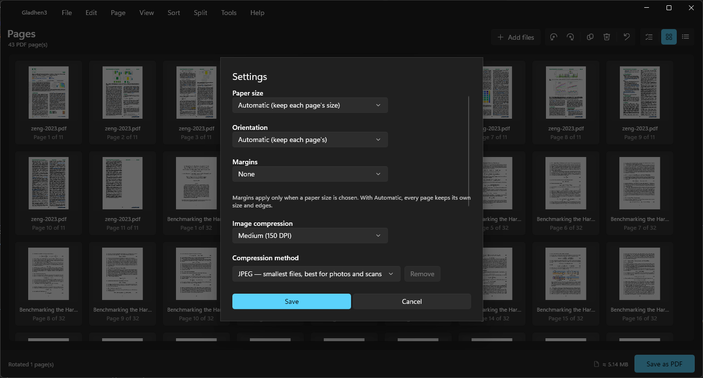
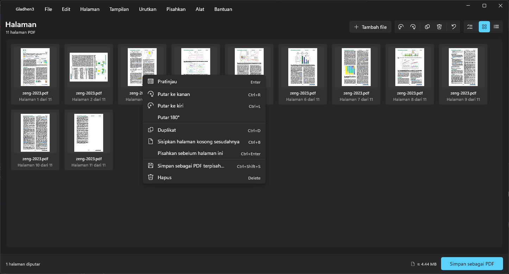
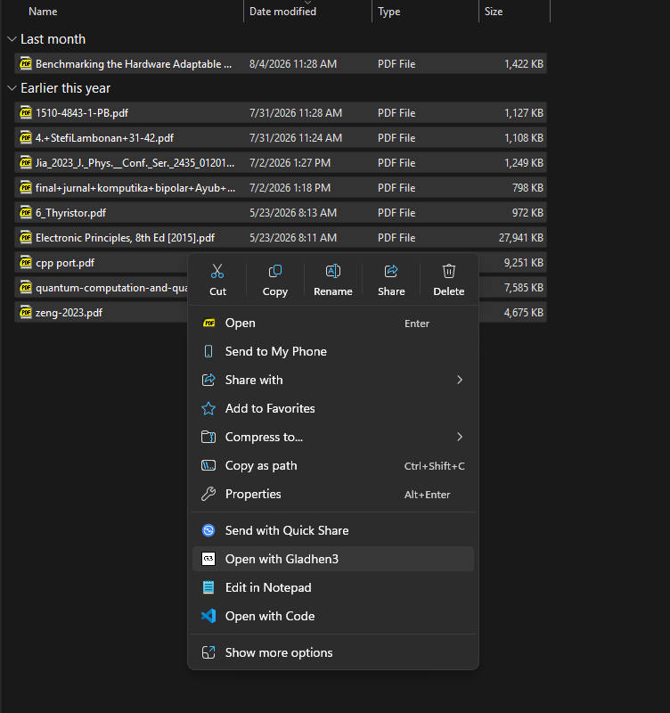

# Gladhen 3

Gladhen 3 is a small, fast PDF tool for Windows. Drop in images and PDFs, fix the pages, and
save: merge, split, rotate, reorder, compress.

Available in **English** and **Bahasa Indonesia**. It follows the Windows display language,
or you can choose one in **Tools > Settings > Language**.

## Features

### Quick page edits

Pages are selected the way files are in Explorer: click a page, Ctrl+click to add or remove
one, Shift+click to take a run, Ctrl+A for all of them, and Esc or a click on empty space to
let go. Each edit works on the selected pages; right-click a page for all of them, and for that
page alone if it is not part of the selection. On a touch screen, select mode (Ctrl+E) puts a
check box on every page instead.

- **Rotate** pages left, right or 180°. A turned page is saved with its rotation flag
  (`/Rotate`), so nothing on it is redrawn or recompressed.
- **Normalize orientation** turns every page so it reads the right way up: scans fed in
  sideways or upside down, phone photos, handwritten notes, PDFs assembled from turned pages.
  With nothing selected it checks every page. A PDF's own text says which way it runs; pictures
  of pages are judged by a small AI model that recognises a turned page without having to read
  it, so it works on handwriting too. Windows' text recognition can back it up on pages the
  model is unsure of. A page it cannot judge, such as a photo with no text, is left as it is,
  and *Select them* picks those out for a look. One undo puts everything back. The model can be
  changed in **Tools > Settings**; see [Orientation models](#orientation-models).
- **Duplicate** pages, or **insert a blank page** the size of the page before it.
- **Reverse** the order of the selected pages, or of every page. This fixes a stack that went
  through the scanner face down.
- **Select odd or even pages**, for example to turn every back side of a duplex scan.
- **Save pages as a separate PDF** to pull a few pages out of a larger file.
- **Undo and redo** every edit.
- **Save straight back over the original.** When every page comes from one PDF, Save opens in
  that PDF's folder with its name filled in. The new file is written beside it and only swapped
  in once it is complete, so a failed save never damages the original.

### Page viewer

Double-click a page, or press Enter, to open it full-window.

- Pages are shown turned the way they will be saved, and stay sharp at any zoom.
- Every page edit is on the viewer's toolbar, and works on the page you are looking at.
- A filmstrip along the bottom jumps to any page.
- Left/Right or Page Up/Down change pages, Home/End jump to the first or last, + and − zoom,
  Ctrl+0 fits the page, and Esc goes back to the list. Double-click zooms in on that spot.

### Building and splitting

- Convert one or many images into a PDF
- Merge PDFs with each other and with images
- Split into several PDFs in one go: before any page, by source file, every N pages, or into N
  parts. Each part's file name can be edited in place.
- Reorder by dragging, with Ctrl+Shift+↑/↓, or sort by name or type
- Choose the paper size (Automatic, A4, Letter, Legal, A3 or custom), orientation and margins,
  including a different margin on each side
- Bookmarks and document information are kept

### Compression

- **Low / Medium / High** presets scale images down to 300 / 150 / 96 DPI. Text and drawings
  stay selectable and sharp, and an image is only re-encoded if that makes it smaller.
- **Choose how images are encoded**:
  - **JPEG** gives the smallest files, best for photos and scans.
  - **Lossless** keeps every pixel (Deflate with PNG predictors), for screenshots and
    diagrams.
  - **Your own codec**: add any DLL that implements the small C interface in
    [`CodecSdk`](CodecSdk/README.md). It could wrap mozjpeg, JPEG 2000, JBIG2, or anything
    else a PDF can hold. A sample black-and-white codec is included.
- **See the estimated file size before you save**, measured with the method you chose.

### Everything else

- Thumbnail and list views
- Explorer context menu: right-click a file and choose *Open with Gladhen3*
- Drag and drop straight into the window

## Supported files

**Images** — JPG, JPEG, PNG, BMP, GIF, TIFF, TIF, WEBP, ICO, JXR, WDP, HDP, DDS

**Documents** — PDF

Every image format is decoded by Windows itself, and a format is only offered if your PC has
the decoder for it. HEIC/HEIF and camera RAW are not supported: they need optional Store
codecs (HEIC also needs Microsoft's paid HEVC extension), so on most PCs they could be added
but never saved.

Photos are placed the way they were taken: the orientation a phone records with each picture is
honoured whether or not the image is compressed.

*Normalize orientation* runs its model on Windows ML, which is part of Windows, so it needs
nothing installed. The optional back-up uses the text recognition that comes with most Windows
display languages; Windows has none for Indonesian, so on a PC set up in Indonesian alone it is
simply skipped, or can be added with English (or any other language) in Settings > Time &
language > Language & region.

The Explorer context menu appears on JPG, JPEG, PNG, BMP, GIF, TIFF, TIF and PDF files.

## Keyboard shortcuts

| Shortcut | Action |
|---|---|
| `Ctrl` + `O` | Add files |
| `Enter` | Open the page in the viewer |
| `Ctrl` + `R` / `Ctrl` + `L` | Rotate right / left |
| `Ctrl` + `Shift` + `R` | Normalize orientation |
| `Ctrl` + `D` | Duplicate |
| `Ctrl` + `B` | Insert a blank page after |
| `Delete` | Remove |
| `Ctrl` + `Z` / `Ctrl` + `Y` | Undo / redo |
| `Ctrl` + `Shift` + `S` | Save the pages as a separate PDF |
| `Ctrl` + `Enter` | Split before this page |
| `Ctrl` + `Shift` + `↑` / `↓` | Move the page up / down |
| Click / `Ctrl` + click / `Shift` + click | Select a page / add or remove one / select a run |
| `Shift` + arrow keys | Extend the selection |
| `Ctrl` + `A` | Select all |
| `Esc` | Clear the selection (and leave select mode) |
| `Shift` + `F10` / menu key | The page's menu, as a right-click opens it |
| `Ctrl` + `E` | Check boxes on every page (select mode), on or off |

In the viewer:

| Shortcut | Action |
|---|---|
| `←` `→` / `Page Up` `Page Down` | Previous / next page |
| `Home` / `End` | First / last page |
| `+` / `−` | Zoom in / out |
| `Ctrl` + `0` | Fit the whole page |
| `Esc` | Back to all pages |

## Screenshots

Every page of every file you have added, ready to be turned, reordered and saved. Three pages
are selected with a click and a Shift+click:



Normalize orientation on a stack of crooked scans, a phone photo held sideways and a PDF with
turned pages. Before:



After one click: every page that has text reads upright, and the photograph, which has none,
is left alone:



The viewer, with a page turned 90° and the filmstrip below:



List view, with the estimated output size next to the Save button:



Settings: the compression method and the orientation model:



In Bahasa Indonesia, with a page's menu open (Shift+F10 opens it from the keyboard):



Right-click a supported file in Explorer:



## Installation

[Get it from the Microsoft Store](https://apps.microsoft.com/detail/9PKH3VS88B8Q?hl=en-us&gl=US&ocid=pdpshare)

Install and run — there is nothing else to download. The .NET runtime is carried inside the
package, and the Windows App Runtime is a framework dependency the Store installs for you.

Requires Windows 10 version 1809 (build 17763) or newer, x64 or x86. The download is about
50 MB for x64 and 46 MB for x86, 6 MB of which is the orientation model; the Store sends only
the one your PC needs.

## For developers

- **Translations** live in `Strings/<language>/Resources.resw`. Every string has to exist in
  every language with the same `{0}` placeholders: a missing string shows up as blank text, and
  a missing placeholder throws when the message is shown. ResXManager shows the gaps.
- **Codecs**: see [`CodecSdk/README.md`](CodecSdk/README.md) for the interface, the checks
  Gladhen 3 runs on a codec's output, and a sample to start from.

## Orientation models

*Normalize orientation* judges pictures of pages with an image classifier that has four
outputs, one per quarter turn. The built-in one is
[PP-LCNet_x1_0_doc_ori](https://huggingface.co/PaddlePaddle/PP-LCNet_x1_0_doc_ori_onnx) from
PaddlePaddle, trained on document images.

**Using another model.** In **Tools > Settings**, choose **Add model…** and pick an `.onnx`
file — for example
[docTR's page orientation model](https://huggingface.co/Felix92/onnxtr-mobilenet-v3-small-page-orientation)
also works. Before a model is added, Gladhen 3 shows it three sample pages at every quarter turn.
That works out how the model wants its input (cropped, fitted or stretched; which
normalisation; RGB or BGR) and what each of its outputs means, so a model whose "90" means
anticlockwise works too. A model that cannot read the sample pages consistently is refused:
one that turns pages the wrong way is worse than none.

To skip the guessing, put a description beside the model with the same name
(`my-model.json` for `my-model.onnx`). Its labels are still checked against the sample pages.

```json
{
  "name": "My orientation model",
  "width": 224,
  "height": 224,
  "resize": "Crop",
  "cropShare": 0.875,
  "channels": "RGB",
  "scale": 0.00392156862745098,
  "mean": [0.485, 0.456, 0.406],
  "std": [0.229, 0.224, 0.225],
  "labels": [0, 90, 180, 270],
  "minimumConfidence": 0.7
}
```

- `resize`: `Crop` scales the short side to `width / cropShare` and cuts out the centre;
  `Fit` scales the long side to fit and pads with black; `Stretch` scales to the input exactly.
- Each channel is fed as `(pixel × scale − mean) / std`.
- `labels`: for each output, in order, how far the page it saw is turned clockwise.
- A page is turned only when the model, shown it at all four turns, gives the same answer every
  time and its averaged probability reaches `minimumConfidence`.

Models run on Windows ML, so a model has to use an ONNX opset the PC's version of Windows
supports. The built-in model uses opset 7, which every supported Windows version runs; newer
models may need Windows 11.

## Third-party

- **PP-LCNet_x1_0_doc_ori** © PaddlePaddle Authors, Apache License 2.0. Shipped unchanged as
  `Assets/Models/pp-lcnet-doc-ori.onnx`; the licence is beside it.
- **PDFsharp** © empira Software GmbH, MIT License.
- **Serilog** © Serilog Contributors, Apache License 2.0.
